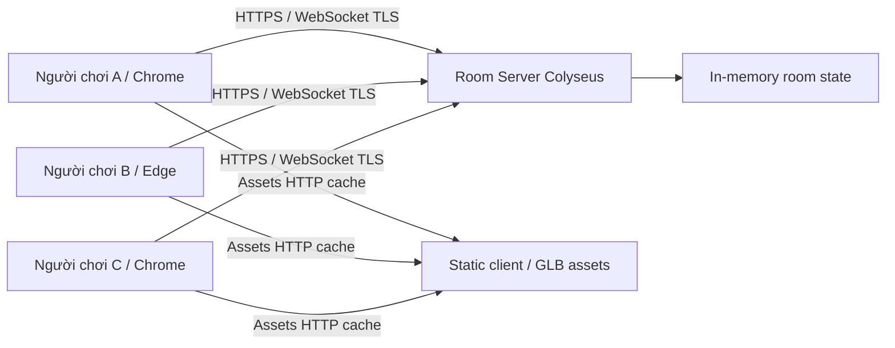

# Technical Architecture — Đà Lạt Hẹn Nhau

**Status:** PROPOSED — technology selection researched 2026-11-05; dependencies and runtime are not yet installed/tested.  
**Goal:** một game multiplayer web thật, invite-only, 2–6 người, 3D continuous scene, đồng bộ sự hiện diện chính xác hơn là thi đấu hay physics phức tạp.

## 1. Architecture decision

**Chọn:** TypeScript monorepo; Vite + Three.js client; Node.js + Colyseus authoritative room server; static GLB/glTF assets; build deploy web client tách khỏi Node process hỗ trợ WebSocket.

| Lựa chọn | Lợi ích | Rủi ro / kết luận |
|---|---|---|
| **Three.js** | Web native, chủ động camera/scene/lighting, GLB loader, dễ chia sẻ link | Phải tự tổ chức game-loop/asset/system; phù hợp sở trường 3Dviz |
| **Colyseus** | Phòng, state patches, lobby/private room, reconnect, server ownership | Thêm một server stateful; tốt hơn tự viết protocol/WebSocket khi online thật |
| Plain WebSocket tự viết | Rất ít dependency | Phải tự giải quyết room, join race, snapshot, reconnect, schema/validation; không chọn v1 |
| Godot Web export | Editor thuận tiện; engine game toàn diện | Build lớn, integration web/invite/UI khác; chưa cần trong v1 |
| Existing offline `Đà Lạt Trong Mơ` renderer | Có thể tham khảo terrain/composition | **Không tái sử dụng engine WebGL/Canvas và hệ nhiệm vụ** như multiplayer nền tảng; viết client mới |

**Không chọn:** database, tài khoản, AI NPC, voice/WebRTC, vật lý xe máy hoặc service worker phức tạp ở slice đầu.

**Source checks:** Colyseus hỗ trợ server-authoritative Schema room state, `setPrivate()`, patch sync và reconnect; công khai code room không đủ bảo mật, phải validate invite token riêng. Xem [State](https://docs.colyseus.io/state), [Room](https://docs.colyseus.io/room), [Private/locked](https://docs.colyseus.io/matchmaker/visibility), [Reconnection](https://docs.colyseus.io/room/reconnection), [Authentication](https://docs.colyseus.io/auth/room). Three.js GLB loader tại [GLTFLoader](https://threejs.org/docs/pages/GLTFLoader.html). Xác minh phiên bản API ngay trước coding, không dùng ví dụ từ phiên bản cũ một cách máy móc.

## 2. System context



**Host của phòng** là người điều khiển trạng thái giờ/ngày trong gameplay; **server** mới là authority về room state, vị trí hợp lệ và quyền thay đổi state. Host gameplay không phải game server process.

## 3. Monorepo đề xuất

```text
dalat-hen-nhau/
├─ apps/
│  ├─ web/                   # Vite + Three.js + HTML/CSS in-game UI
│  │  └─ src/
│  │     ├─ game/            # world, avatar, camera, render loop, inputs, photo
│  │     ├─ network/         # Colyseus SDK, client state adapters
│  │     └─ ui/              # room/lobby/HUD/chat/settings
│  └─ server/                # Node.js Colyseus, auth, rooms, input validation
├─ packages/
│  └─ shared/                # typed messages, constraints, map/seat IDs
├─ assets/
│  ├─ world/                 # scene data, exported models, PBR textures
│  ├─ avatars/               # rigged glb, emote clips
│  └─ audio/                 # licensed ambient, footsteps
├─ docs/                     # game design, visual system, ADR, evidence
└─ tests/                    # room integration + 2-client E2E
```

Không viết cấu trúc giả định vào repo có sẵn. Khi có repo thực, đọc `AGENTS.md` mới nhất, kiểm tra stack rồi hiệu chỉnh cấu trúc trước khi sửa code.

## 4. Shared state, no unnecessary persistence

**`RoomState` (server owned)**

| Field | Semantics | Update |
|---|---|---|
| `players: Map<id, PlayerState>` | các session đang hoạt động / tạm mất kết nối | onJoin/onDrop/reconnect/leave |
| `environmentPreset` | `morning-mist` / `clear-afternoon` / `purple-dusk` | host request hợp lệ |
| `hostPlayerId` | host để đổi ambience / kick | server selects/promotes |
| `seatOwners: Map<seatId, playerId>` | mỗi vị trí ngồi tối đa một người | sit / stand / disconnect cleanup |

**`PlayerState`**: `id`, `displayName`, `avatarVariant`, `position {x,y,z}`, `heading`, `locomotionState`, `seatId` (rỗng nếu đang đứng), `emoteId`, `emoteEndsAt`. Emote/seat là state authoritative; camera, UI visibility và graphics setting **không đồng bộ**. Photo PNG chỉ tồn tại trên client.

Vì Colyseus `Schema` có hạn chế tuần tự hóa theo field, biểu diễn `seatId` vắng bằng giá trị nhất quán trong wire contract; không mặc định dùng nullable string không kiểm tra (tài liệu Schema nêu null string encode khác). Chốt type cụ thể khi tạo code.

## 5. Communication protocol, proposed

### Reliable lifecycle / commands

| Command | Payload sample | Server rule |
|---|---|---|
| `moveInput` | `{seq, forward, strafe, heading, dt}` | validate finite bounded numbers, monotonic sequence, turn rate và speed |
| `sit` | `{seatId}` | seat tồn tại, chưa bị chiếm, player ở gần (<2m) |
| `stand` | `{}` | giải phóng seat, restore controllable state |
| `emote` | `{type}` | allowlist 5 loại, server cooldown, không vượt animation timeline |
| `chat` | `{text}` | giới hạn 120 ký tự, sanitization, throttling, room broadcast |
| `setEnvironment` | `{preset}` | host only, enum allowlist, cooldown 15–30s |
| `kick` | `{playerId}` | host only, audit log tối thiểu trên server, không cho kick tùy tiện |

**`photo` không có server command** vì snapshot local. `invite/create` là HTTP hoặc matchmaking gate riêng, không phải message broadcast tùy ý.

### Client rendering and simulation

- Server mô phỏng bước đi và kiểm tra map walkable. Mục tiêu **20 ticks/s**, kiểm tra smoothness thực tế. Colyseus patch default **50 ms (20 Hz)**, có thể tối ưu sau khi đo bandwidth. <https://docs.colyseus.io/room>
- Client render độc lập mục tiêu 60 FPS (đánh giá đạt ở ≥30 FPS trên máy đích). Remote avatars interpolation, không đo bằng tốc độ mạng giả định.
- Own-avatar camera có thể chạy theo input local tức thời; với correction từ server thì chuyển vị trí mượt, tránh giật. Không xây prediction/rollback nâng cao khi chưa cần.
- Server giữ quyền đối với ghế/ngữ cảnh; user không thể tự gửi tọa độ bất kỳ hoặc chiếm ghế từ xa bằng message thô.
- Không dùng multiplayer physics hay combat; di chuyển trên navmesh đơn giản/heightmap có kiểm soát.

## 6. Private room + reconnect + abuse resilience

1. Client tạo phòng qua endpoint có rate limit; backend tạo room private và invite token đủ entropy. **Room private chỉ ẩn khỏi matchmaking, không thay thế xác thực:** `joinById()` vẫn có thể vào nếu biết room ID theo tài liệu Colyseus.
2. Link mời gồm opaque token, kiểm tra trên server trước khi cấp seat. Không để token trong source/bundle; tránh log token/raw URL và không dùng room ID đoán được làm mật khẩu.
3. Guest nickname 2–24 ký tự, strip control chars, escape HTML, không mở clickable URL từ chat; người chơi được mute người khác ở client.
4. Tối đa 6 seats, 1 seat/session; enforce rate limits cho join, input, chat, emote. Host có quyền kick, nhưng không có quyền thay đổi vị trí người khác.
5. Network drop: gọi reconnection theo SDK phù hợp; **giữ seat tối đa 45s** (design target), khi reconnect nhận state snapshot đúng; quá hạn remove avatar và seat. Nếu host mất mạng tạm, không chuyển quyền cho đến khi seat hết hạn.
6. Nếu host rời phòng tự nguyện, chọn host tiếp theo theo join order; notify bằng toast nhỏ. Phòng rỗng tự dispose; không có DB hoặc chat logs dài hạn.
7. Room không public: chống nuisance cơ bản, nhưng **không tuyên bố bảo mật tuyệt đối** chỉ bằng mã mời. Khi public release phải threat-model thêm DDoS, session abuse và operational limits.

## 7. Loading/render/asset policy

- Target client: Chrome/Edge desktop có WebGL2; khi không có WebGL, hiện thông báo khả năng tương thích rõ ràng. Không coi CPU screenshot từ prototype cũ là GPU QA.
- Load các asset quan trọng theo nhóm: world basic → avatar → detailed props → audio (sau user consent). Spinner/progress phản ánh asset load thật.
- Three.js GLTFLoader xử lý GLB. Dùng geometry instancing cho cây giống nhau khi phù hợp, nhưng variation shape/branch structure vẫn phải được thiết kế để tránh rừng bản sao.
- Dùng texture optimized + mipmaps + LOD, có 2 preset `Low`/`High`, shadow/fog có ngân sách, không bật tất cả screen effects mặc định.
- Dispose geometries, materials, textures, mixers, listeners, animation frames đúng lifecycle; không leak khi rời/đổi room.
- Capture photo phải tạo ảnh hợp lệ ngay cả khi WebGL canvas buffer bị clear, tránh cross-origin texture taint và kiểm tra export PNG thật trong trình duyệt.

## 8. Deployment choices

**Development:** client ở `localhost:5173` và server ở `localhost:2567` (chỉ là port *dự kiến*). Test 2 browser; tiếp đó test máy khác qua LAN / endpoint public thử nghiệm.

**Public friends test:** HTTPS static hosting cho client; Node.js stateful server có WebSocket Secure (WSS), reverse proxy/TLS, health checks và giới hạn concurrent room. Không chạy Colyseus room process trong request/response serverless function không duy trì kết nối. Không cần Redis khi chỉ có một instance; thêm khi có demand scale nhiều instance.

**Observability tối thiểu:** room count, join success/fail, reconnect success, average/p95 RTT test, memory, WebSocket disconnect cause, client JS exceptions, render FPS developer overlay. Không log ảnh người chơi/chat text/invite tokens. Không thêm analytics tracking hành vi mặc định.

## 9. Technical ADR summary

- **ADR-01:** One polished world scene first, not multiple disconnected maps. Rationale: visual density and real connection are greater value; review after first group playtest.
- **ADR-02:** Colyseus over custom WebSocket for room and reconnect correctness. Rationale: reduce bespoke networking failure modes; adds backend dependency.
- **ADR-03:** Server controls position/seat/chat rules; client only controls camera/photo and proposes inputs. Rationale: consistency/abuse guard, tolerate low stakes.
- **ADR-04:** No DB/login/voice v1. Rationale: fast entry, privacy and focus on proximity.
- **ADR-05:** Photo snapshots stay on user's device, never in shared state. Rationale: simple privacy and low infra cost.

## 10. Validation requirements

**This document is design, not evidence.** No claims of completed multiplayer implementation or WebGL GPU QA. Validate API shape against exact dependency version when implementing, then run test plan in `TEST_PLAN.md` before release.
