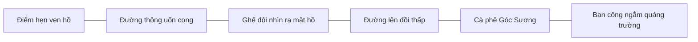

# Experience Design & 3D Art Direction

**Status:** PROPOSED; không phải ảnh render hoặc scene đã kiểm chứng.

## 1. Hướng nghệ thuật đã chọn

**“Sương đầu mùa — Đà Lạt hiện hữu và ấm áp.”** Semi-stylized painterly realism: hình khối và cây cối có cấu trúc tốt, vật liệu có phản ứng ánh sáng, màu sắc dịu, chất liệu hơi thủ công, không low-poly hộp khối, không hyperreal nặng GPU. Một không gian yên tĩnh mà nhóm bạn có thể đứng nhìn 2–3 phút không chán.

**Trọng tâm hình ảnh:** mặt nước và đường cong ven hồ; lớp thông foreground/midground; đồi trập trùng chìm trong hơi sương; ánh vàng của quán cà phê cân bằng nền xanh lạnh; bóng kiến trúc Quảng trường Lâm Viên ở xa.

Không cắt ảnh stock/Getty thành texture, không bê nguyên ảnh công trình làm skybox khi chưa có quyền sử dụng. Asset tự dựng hoặc nguồn có giấy phép rõ ràng.

## 2. Bản đồ tuyến trải nghiệm (không có nhiệm vụ)

- **World bounds:** khoảng 300×220 m, scale 1 đơn vị = 1 m; elevation thấp nhất mặt nước, đường dốc nhẹ để người không quen game không lạc hướng.
- **Walkable trail:** uốn cong từ spawn đến cafe, khoảng 220–280 m đường đi; 2–4 phút đi bộ nhẹ, có lối quay lại và các khoảng nghỉ.
- **Photo viewpoints:** (a) bậc thềm mép hồ: cả 6 người và mặt hồ; (b) hàng thông: foreground tạo khung; (c) ban công quán: nhìn về một silhouette đặc trưng của Quảng trường Lâm Viên.
- **Horizon:** đồi thông 3 lớp; công trình nằm xa theo bố cục nghệ thuật. Không dựng Ga Đà Lạt ở ngay cạnh hồ chỉ để nhồi địa danh.
- **Visibility:** bạn bè ở gần có silhouette không bị sương che quá mức; luôn có đường chân trời làm mốc định hướng.

## 3. Ngôn ngữ hình khối

| Object | Silhouette / proportions | Vật liệu & chất lượng |
|---|---|---|
| Thông Đà Lạt | thân vươn cao, nhiều tầng cành, tán bất đối xứng có khoảng âm | vỏ có rãnh; tán không phải hình nón trơn; gió nhẹ theo cụm |
| Hồ & bờ nước | cong hữu cơ, đường viền có bậc đá, vài mép cỏ | sóng nhỏ; gradient sâu/nông; phản xạ nhẹ; không hồ gương hoàn hảo |
| Quán cà phê | mái ngói nghiêng, mặt kính chia nhịp, ban công nhìn hồ | gỗ mờ, kim loại sơn tối, kính cho thấy nội thất ấm |
| Đường đi | đường lát đá mảnh, viền gờ; độ dốc dễ đi | độ nhám, màu biến thiên có quy luật; tránh lặp texture rõ |
| Avatar | tỷ lệ stylized trung tính, áo khoác / khăn mỏng, giày | chuyển động có trọng lượng; bàn chân tiếp đất; ngồi đúng độ cao |
| Lam Viên phía xa | nhận diện bằng khối kiến trúc cách điệu mang tính gợi nhớ | không tuyên bố là bản sao kiến trúc chính xác |

**Bộ skill 3D đã tra cứu thật bằng `upstream/scripts/search.py`:** `knowledge.blueprint-tree-conifer`, `knowledge.material-water-surface-cues`, `knowledge.camera-orbit-follow-rig`, `knowledge.style-stylized-realism`, `knowledge.motion-style-with-state-legibility`, `knowledge.theme-fantasy-woodland`. Đây là **ứng viên tham khảo**; không biến world thành làng fantasy, không khẳng định kit đã được import vào game.

## 4. Color + environment tokens

| Token | Hex | Ý định sử dụng |
|---|---|---|
| `pine-deep` | `#24483F` | tán thông tối, chiều sâu |
| `pine-haze` | `#6F8C79` | lớp thông xa trong sương |
| `lake-teal` | `#78A3A4` | mặt hồ, phản xạ sáng |
| `sky-lilac` | `#BFB5CA` | sương đầu ngày, hơi tím |
| `light-honey` | `#E9BC71` | đèn quán và nắng cuối ngày |
| `roof-clay` | `#A96655` | mái ngói / đất nung |
| `hud-ink` | `#1F332F` | overlay đậm, nền HUD |
| `hud-paper` | `#F8F3E8` | chữ sáng và menu |

Tokens là định hướng khởi đầu, phải xác nhận trên screenshot in-engine, không bảo đảm độ tương phản khi nền thế giới động. Không dùng màu làm tín hiệu duy nhất.

## 5. Lighting, fog, weather

- **Sáng sớm (mặc định):** key ánh nắng xiên mềm; volumetric-like fog nhẹ theo khoảng cách, không che người chơi trong vùng xã hội gần; mặt hồ lạnh.
- **Chiều trong:** màu sắc tươi hơn, shadow rõ vừa phải; đọc tốt kiến trúc.
- **Chiều tím:** ánh nền tím/xanh, practical đèn quán vàng là điểm ấm; không bloom mù, highlight không cháy.
- Mỗi preset có directional/ambient/environment light rõ quyền sở hữu; thử tại cùng góc camera và cùng exposure khi duyệt màu.
- Giữ chất lượng không khí là đặc tính Đà Lạt nhưng không hy sinh visibility/comfort. Tùy chọn giảm sương và reduced-motion là **local-only graphics/accessibility**.

## 6. Camera, animation và trạng thái

- Camera third-person follow cách nhân vật khoảng 3–5 m, hơi cao hơn mắt, xoay tự do có giới hạn pitch; mượt nhưng không delay nặng.
- Tự động tránh tán cây/mái nhà chắn camera; camera không đi xuyên kết cấu hoặc nhìn dưới nền.
- `C` đổi góc camera gần/xa (gợi ý), `P` vào Photo mode; `Esc` thoát mode. Dùng WASD/mũi tên khi chat không focus.
- Motion: avatar idle có nhịp thở, bước đi có chân chạm mặt đất; emote giữ cơ thể neo ở vị trí, không làm nhân vật trượt.
- Thời tiết là state chung; camera và cài đặt đồ họa là state cá nhân.

## 7. HUD & interaction UX

**Trang trước khi vào:** không landing page marketing nhiều thẻ. Một ảnh/cảnh preview nhẹ và hai hành động nổi bật **Tạo phòng riêng** / **Vào phòng bằng link**. Tên hiển thị, chọn avatar rồi vào. Invite link có nút copy và thông báo thành công/thất bại.

**Khi đang chơi:** khoảng 85–90% diện tích viewport dành cho cảnh. HUD mỏng: góc trên tên phòng + số người, góc phải chia sẻ/âm thanh/cài đặt; góc dưới biểu cảm + chat thu gọn + máy ảnh. Nhãn avatar chỉ xuất hiện trong bán kính phù hợp, fade khi xa, không hiện xuyên núi/cây nếu gây sai trực giác.

**Cảnh nhìn yên tĩnh:** HUD phụ fade khi không tương tác; `H` ẩn UI để ngắm; các chức năng cần thiết vẫn tìm lại được bằng phím/menu. Không overlay hướng dẫn dài và không badge nhiệm vụ.

**Menu emote:** 5 biểu tượng có chữ khi focus/hover; bấm `1–5` nhanh hoặc click; animation/emote server relay, có cooldown. Tùy chọn giảm emoji effects và tắt chat.

**Photo mode:** camera chiếm toàn màn hình, nút `Chụp ảnh` luôn rõ, khung ngắm tối giản, trước khi save có preview và nút quay lại. Không tự động ghi ảnh bạn bè lên cloud.

**Trạng thái bắt buộc**: connecting, loading asset (progress thật), waiting for room, room full, expired link, reconnecting, disconnected/failed, empty chat, seat occupied, save photo failed/no permission, WebGL unsupported. Lỗi có ngôn ngữ thân thiện và đường thoát/hành động tiếp theo.

## 8. Accessibility & visual quality gate

- HUD keyboard navigable, focus visible, `Esc` thoát modal; điều khiển game không bắt phím khi đang nhập chat.
- Text và nút phù hợp contrast ≥4.5:1 trên nền HUD ổn định, icon-only có accessible name; không đánh giá contrast trên một frame đẹp duy nhất.
- Ở desktop target từ 1366×768; kiểm tra 1280×720, 1440×900, 1920×1080. UI không tràn trên màn hẹp; mobile v1 hiển thị lời nhắc “Tối ưu cho máy tính” thay vì giả vờ điều khiển cảm ứng hoàn chỉnh.
- Respect `prefers-reduced-motion`: giảm camera easing, sway/fog noise và hạt; chuyển thời tiết có thể instant fade dịu.
- Có tùy chọn độ phân giải render, shadow/fog/reflection. Chưa đo FPS thì mọi con số là **target**, không phải PASS.

## 9. Âm thanh

Gió thông, chim xa, bước chân theo vật liệu, tiếng nước nhỏ và không khí quán cà phê rất nhẹ. Âm thanh không tự bật quá lớn; có nút mute chung, ambient êm và có lựa chọn không nhạc. Chỉ dùng âm thanh tự tạo hoặc asset có quyền phân phối; không lấy nhạc acoustic có bản quyền từ video/social.

## 10. Tham khảo và phân biệt tính chính xác

- [Du lịch Việt Nam — Đà Lạt](https://vietnam.travel/vi/places-to-go/central-vietnam/da-lat): hồ, rừng thông, địa hình cao nguyên và kiến trúc.
- [Cổng du lịch Đà Lạt — hồ Xuân Hương](https://dalat.vn/en/hoxuanhuong): không gian quanh hồ.
- [Cổng du lịch Đà Lạt — Ga Đà Lạt](https://dalat.vn/en/nhagadalat): tham khảo khi mở rộng zone riêng.
- Không dùng ảnh preview từ nguồn báo/stock làm asset game khi chưa được cấp phép. Bối cảnh được **gợi cảm hứng** bởi địa danh thật, không phải sản phẩm hướng dẫn giao thông.

**Phản biện đề xuất tự động của UI UX Pro Max:** truy vấn `cozy multiplayer social game travel nature scenic exploration --design-system` trả về pattern marketing `Feature-Rich Showcase` và style `3D & Hyperrealism`. Ta **chỉ tiếp nhận tiêu chí 3D immersive & accessibility**, loại bỏ marketing hero/cards và hyperrealism nặng vì không phục vụ in-game social experience. Truy vấn stack `threejs` có kết quả về camera, color management và InstancedMesh; các khuyến nghị vẫn phải đối chiếu phiên bản Three.js thực tế lúc coding.
